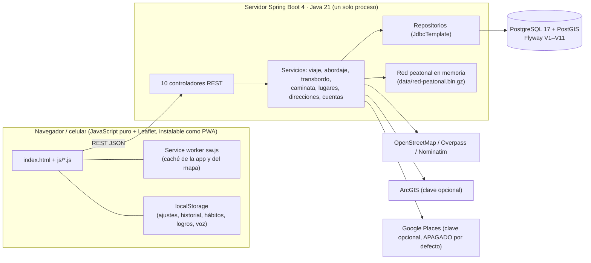
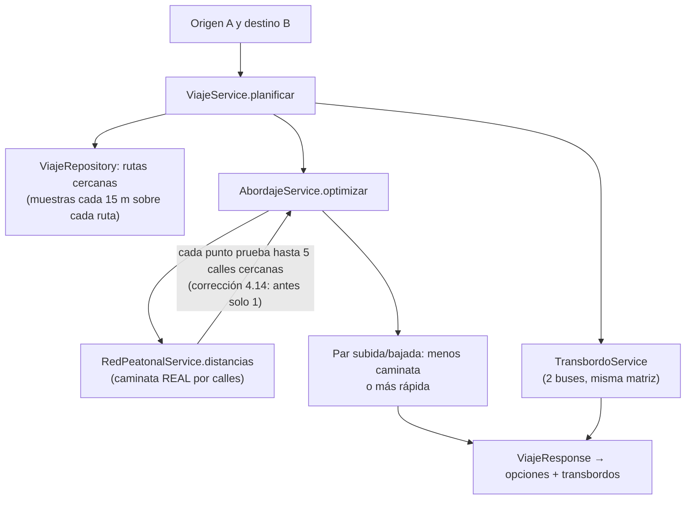
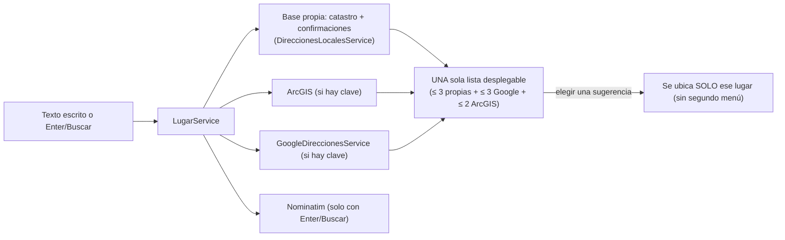
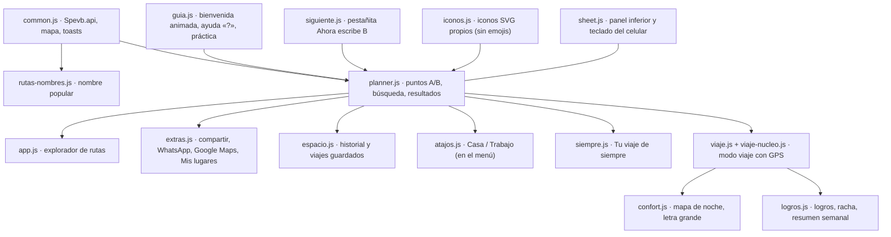

# Grafo del proyecto SEVB · lo importante para no olvidarlo

> Mapa de cómo se conecta todo y de las decisiones que no se deben perder. Complementa a `CONTINUIDAD.md` (reglas del dueño, cómo correr y probar).
> Se lee en cualquier visor de Markdown que dibuje Mermaid (GitHub, VS Code con extensión, IntelliJ). Hecho a mano desde el código de la versión 4.13.1 + mejoras 4.14; si algo cambia, actualiza este archivo junto con `CHANGELOG.md`.

## 1. Arquitectura (quién habla con quién)



## 2. El corazón: cómo se elige dónde subir y bajar



**Lo que no se debe olvidar de esta parte**
- La caminata se mide por la **red de calles propia** (`RedPeatonal`), no en línea recta. Troncales cuestan 2,5 veces, puentes 0,75.
- Un punto de la ruta pegado a una calzada sin conexión cercana ya NO se descarta: `RedPeatonalService.distancias` prueba varias calles (`CALLES_DESTINO = 5`). Prueba: `RedPeatonalTest.unPuntoPegadoAUnaCalzadaSinConexionCercaUsaLaCalleVecina`.
- Se compara siempre contra el sentido de la ruta (IDA/REGRESO/CIRCULAR): un sentido contrario sale aparte con advertencia.

## 3. Direcciones (de dónde salen las sugerencias)



**Lo que no se debe olvidar**
- Elegir una sugerencia (clave `magicKey`; Google lleva el prefijo `g:`) devuelve **un solo lugar**. Los resultados de Enter/Buscar usan el mismo menú desplegable (`suggestion-open`), así solo hay una lista abierta.
- Google **no guarda nada** de lo que devuelve, la clave va en una cabecera desde Java y nunca al navegador. **Pendiente de confirmar:** las condiciones de Google sobre mostrar sus resultados en un mapa que no sea de Google (ver `docs/GOOGLE-MAPS.md`).

## 4. El navegador por dentro (módulos JavaScript)



**Lo que no se debe olvidar**
- `viaje-nucleo.js` es lógica pura (sin pantalla; el modo viaje no usa voz): dice «paradero», «letrero» y **cuadras** (≈ 100 m). Las preguntas «¿Vas en la ruta…?» / «¿Ya te bajaste?» no se cambian: hay pruebas que las exigen.
- El nombre popular de la ruta (`Spevb.rutaNombre(codigo)`) sustituye al código en todo texto que ve la persona; **los códigos siguen siendo la clave interna** (favoritos, historial, reportes).
- El panel inferior reserva espacio con la lista abierta (`.suggesting .sheet-body`): sin eso, en celulares pequeños con teclado las sugerencias de B quedan fuera de la vista.

## 5. Datos (migraciones y tablas)

```mermaid
flowchart LR
    V1["V1 rutas · paraderos · revisiones"] --> V2["V2 direcciones · lugares · barrios · pois"]
    V2 --> V3["V3 pasos peatonales"] --> V4["V4 tipo PUENTE"]
    V4 --> V5["V5 reportes"] --> V6["V6 cuentas"] --> V7["V7 Google (inicio de sesión)"]
    V7 --> V8["V8 paraderos del sistema"] --> V9["V9 alias de código de ruta"]
    V9 --> V10["V10 versión de pasos"] --> V11["V11 nombre_popular en rutas (4.14)"]
```



**Lo que no se debe olvidar**
- Las migraciones son **aditivas e idempotentes**; Flyway **no deja arrancar** una carpeta cuyo código no conozca una migración que la base ya tiene (error «Detected applied migration not resolved locally: 11»). **Se arranca siempre desde `SEVB-4.12.1`**, no desde `SEVB-V3.4`.
- Nunca probar contra la base real con copias de la app: mis pruebas con la base del dueño aplicaron V11 antes de tiempo. Para pruebas usar la base desechable de las pruebas (Testcontainers) o el stub.
- Nunca `docker compose down -v` (borra los datos).

## 6. Mejoras 4.14 (para no repetirlas ni perderlas)

| Tema | Dónde está | Prueba |
|---|---|---|
| Punto de subida más cercano de verdad | `RedPeatonalService.distancias` | `RedPeatonalTest` |
| Nombre popular de la ruta | V11, `RutaController /rutas/nombres`, `rutas-nombres.js`, campo en el editor | `RutaServiceTest`, `mejoras414_e2e.py` |
| Mapa de noche, letra grande | `confort.js` | `mejoras414_e2e.py`, `aprender_e2e.py` |
| Línea de tiempo, WhatsApp, Google Maps (enlace) | `planner.js`, `extras.js` | `mejoras414_e2e.py` |
| Google para direcciones (opcional) | `GoogleDireccionesService`, `LugarService` | `GoogleDireccionesServiceTest`, `LugarServiceGoogleTest` |
| Un solo menú de sugerencias | `planner.js` + `LugarService.buscarDetallado` | `mejoras414_e2e.py` |
| Bienvenida animada, ayuda «?», práctica robusta | `guia.js` | `aprender_e2e.py` |
| Pestañita «Ahora escribe B» (sin mover la pantalla) | `siguiente.js` | `aprender_e2e.py` |
| Iconos propios, sin emojis; controles del bus en círculo | `iconos.js`, `bus.js` | `aprender_e2e.py` |
| Tu viaje de siempre, resumen semanal, logros | `siempre.js`, `logros.js` | `aprender_e2e.py` |
| Rendimiento del cálculo de viajes (cachés y rejillas de muestras) | `RedPeatonal` (`ajustarVarios`, `ajustarVariosGuardado`, `Monticulo`), `ViajeRepository` (`muestras`, `huella`, `tramosEntre`), `docs/RENDIMIENTO.md` | `RedPeatonalEquivalenciaTest`, `MuestrasPostgisTest` |

## 7. Trampas que ya costaron tiempo (no repetir)

1. **ZIP:** `Compress-Archive -Path archivo1,archivo2` **aplana** las carpetas. Usar Python (`zipfile`) con la ruta relativa de cada archivo.
2. **Maven y fechas:** al restaurar un `.java` con `Copy-Item` queda con fecha vieja y Maven no lo recompila; hay que actualizar `LastWriteTime`.
3. **`hidden` no basta:** los estilos de botón (`display:inline-flex`) pueden ganarle al atributo `hidden`; añadir una regla `[hidden]{display:none !important}` en ventanas nuevas.
4. **`z-index` de listas:** los botones de «Buscar / En el mapa» tapaban las sugerencias; con la lista abierta quedan detrás (`:has(.suggestion-open)`).
5. **Playwright:** `page.evaluate("x = promesa()")` espera la promesa; para no bloquear usar `() => { x = promesa(); }`.
6. **Pruebas de navegador con 2 ejecuciones a la vez** pueden fallar por carga; correr la suite completa sola y repetir una prueba dudosa suelta.
7. **Pruebas de celular:** el arnés (`e2e/sevb_e2e.py`, `INIT`) marca la bienvenida y la voz como ya contestadas; una prueba que las necesite debe quitar la marca antes de recargar.
8. **Secretos:** el `.env` y la clave de Google no van en ZIPs, capturas ni chats. Una clave que se ve en una captura se **cambia**.
9. **Reglas del profesor:** NO usar emojis (todo icono es propio, SVG) y NO usar voz. Cualquier símbolo nuevo debe ser un SVG de `iconos.js`.
10. **Orden de entrega del dueño:** primero un ZIP con los cambios, luego la batería de pruebas, y un ZIP final solo si algo cambió.
11. **Medir rendimiento:** usar `127.0.0.1` y no `localhost` (IPv6 suma ≈ 2 s por solicitud en Windows), una COPIA de la base (nunca la real) y el límite de solicitudes apagado solo en esa instancia; la caché de planes dura 90 s, así que cada medición necesita pares nuevos.
12. **Cachés de muestras:** dependen de la huella de `ViajeRepository.huella()` y de `ViajeService.invalidarCache()`. Una edición manual en la base que no suba `rutas.version` no se ve hasta 10 min o hasta invalidar.

## 8. Cómo correr y probar (resumen)

```powershell
cd "<carpeta-del-proyecto>"
powershell -ExecutionPolicy Bypass -File .\start.ps1 -NoDatabase   # arrancar
mvn -o test                                                        # Java (Testcontainers para PostGIS)
python e2e/run_e2e.py                                              # navegador completo con stub
python e2e/js_syntax.py                                            # sintaxis de todos los JS
```
